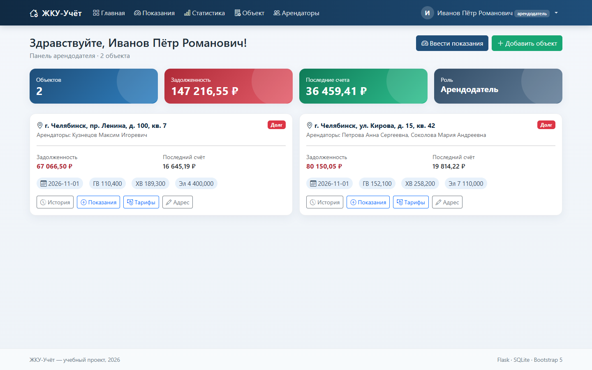
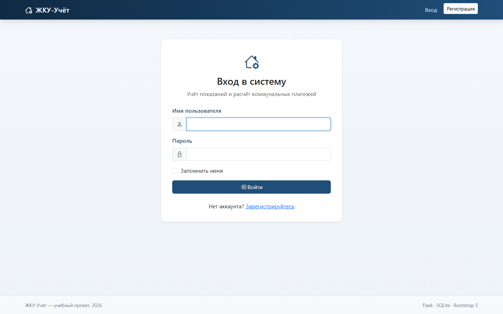
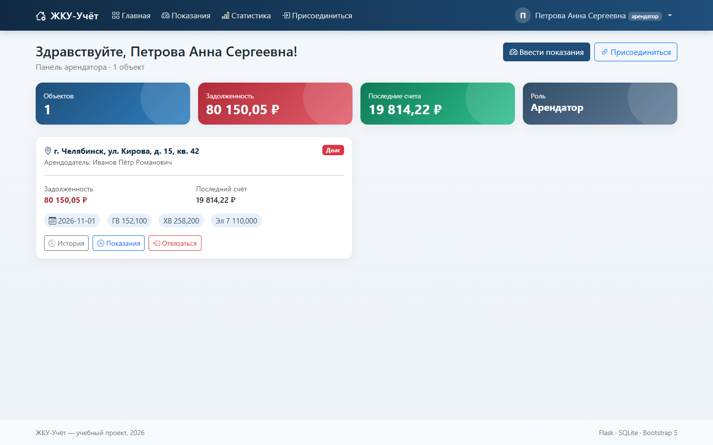
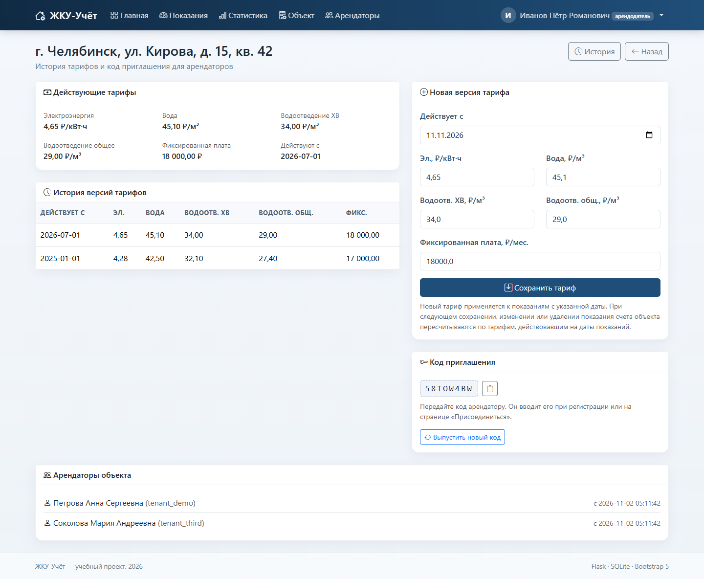
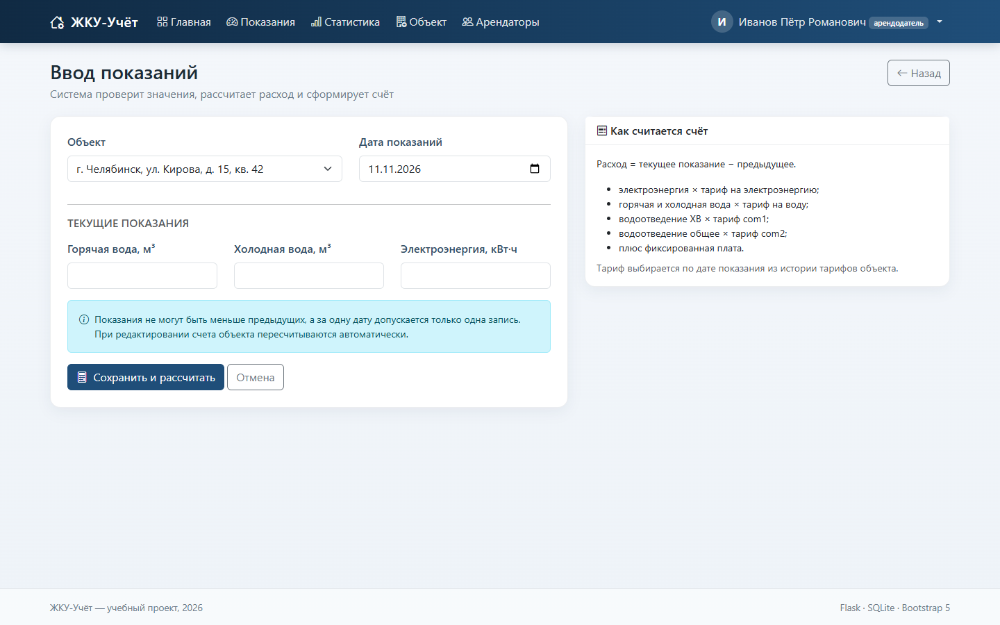
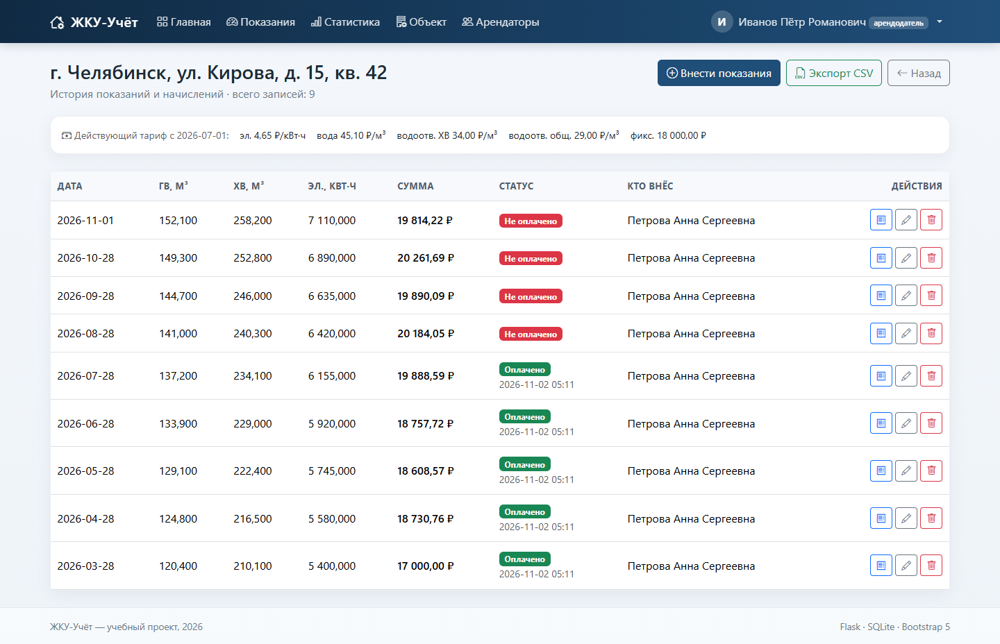
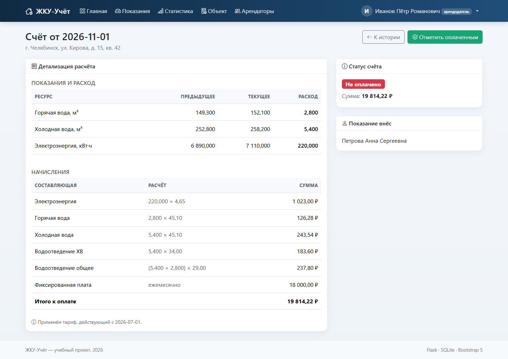
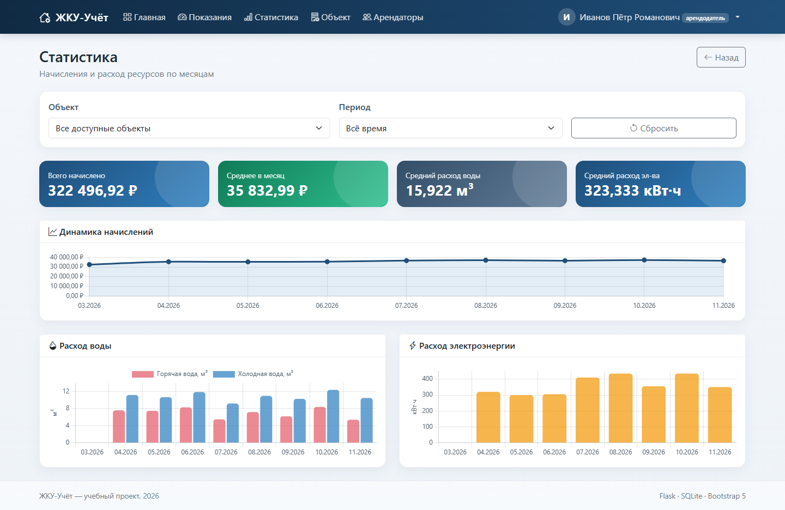
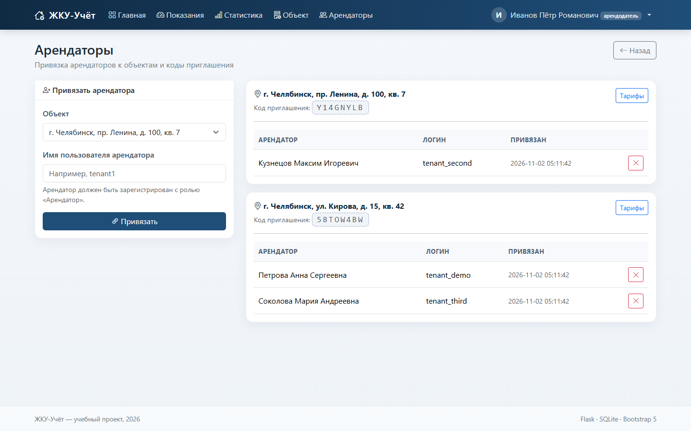
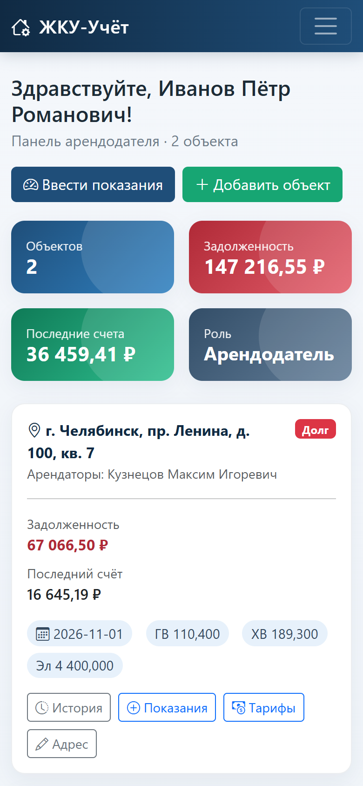

# ЖКУ-Учёт

Веб-система учёта показаний приборов учёта и автоматического расчёта платы
за коммунальные услуги. Учебный проект по дисциплине «Управление жизненным
циклом ИС».

<p align="center">
  
</p>

<p align="center">
  <a href="https://www.python.org/"></a>
  <a href="https://flask.palletsprojects.com/"></a>
  <a href="https://www.sqlite.org/"></a>
  
  
  <a href="LICENSE"></a>
</p>

## Возможности

- регистрация и вход с ролями `owner` (арендодатель) и `tenant` (арендатор);
- несколько объектов недвижимости у одного арендодателя;
- версии тарифов с датой начала действия и сохранением истории;
- дневной и ночной тарифы электроэнергии (необязательные зоны);
- привязка арендатора по коду приглашения или назначение арендодателем;
- несколько арендаторов на одном объекте с настраиваемыми долями оплаты;
- ввод показаний горячей и холодной воды, электроэнергии, а также зон
  день/ночь;
- автоматический расчёт счёта с детализацией каждой суммы;
- пересчёт истории при изменении показаний или тарифов;
- частичные платежи, полная оплата и автоматическое закрытие счёта;
- история с фильтрами по датам и статусу оплаты, экспорт в CSV;
- печатная форма квитанции с сохранением в PDF средствами браузера;
- статистика, графики и сравнение объектов;
- журнал действий `audit_log` с фильтром по типу операции;
- мягкое архивирование объектов без удаления истории;
- read-only REST API с токеном или сессионной авторизацией;
- email-уведомления о счетах и напоминания (SMTP, по умолчанию отключены);
- PWA: установка на экран телефона, офлайн-заглушка и локальные
  Bootstrap/Chart.js без CDN;
- защита от перебора пароля, security-заголовки и API-токены;
- миграции существующей базы, резервное копирование и Docker-развёртывание;
- адаптивный интерфейс для телефона и компьютера.

## Быстрый старт

Требуется Python 3.12.

```powershell
python -m venv .venv
.venv\Scripts\Activate.ps1
pip install -r requirements.txt

# Демонстрационные данные (пересоздаёт instance/utility_billing.db)
python seed_demo.py

# Запуск приложения
python app.py
```

Для Linux/macOS:

```bash
python3 -m venv .venv
source .venv/bin/activate
pip install -r requirements.txt
python seed_demo.py
python app.py
```

Приложение откроется по адресу <http://127.0.0.1:5000>. Сервер по умолчанию
слушает все интерфейсы (`0.0.0.0`), поэтому им можно пользоваться и с других
устройств в локальной сети:

1. Узнайте IPv4-адрес компьютера командой `ipconfig`.
2. Откройте на телефоне или другом ПК `http://<IPv4>:5000`.
3. При необходимости разрешите Python входящие подключения в брандмауэре
   Windows для частной сети.

При первом запуске существующая база автоматически обновляется миграциями
из `migrations.py`. Подробнее: [запуск и развёртывание](docs/deployment.md).

### Docker

```bash
docker compose up --build
```

Контейнер слушает порт `8000`, база и логи хранятся в томе `hau_data`.
Перед публикацией обязательно задайте собственный `SECRET_KEY`.

## Демонстрационные учётные записи

Пароль всех пользователей: `demo12345`.

| Логин | Роль | Объекты |
|---|---|---|
| `owner_demo` | арендодатель | 2 объекта |
| `owner_second` | арендодатель | 1 объект |
| `tenant_demo` | арендатор | 1 объект |
| `tenant_second` | арендатор | 2 объекта |
| `tenant_third` | арендатор | 1 объект |

## Скриншоты

| Вход в систему | Панель арендатора |
|---|---|
|  |  |

| Тарифы и код приглашения | Ввод показаний |
|---|---|
|  |  |

| История показаний и счетов | Детализация счёта |
|---|---|
|  |  |

| Статистика и графики | Арендаторы объектов |
|---|---|
|  |  |

<p align="center">
  
</p>

Все изображения находятся в каталоге [`docs/screenshots`](docs/screenshots).
Скриншоты сняты на демонстрационных данных из `seed_demo.py`.

## Как рассчитывается счёт

Расход определяется как разница между текущим и предыдущим показанием.
Первое показание является начальной точкой отсчёта: расход по нему не
начисляется, к оплате предъявляется только фиксированная плата. Расход,
потреблённый до первого показания, не восстанавливается — это осознанное
упрощение модели.

```text
электроэнергия      = расход_эл × тариф_эл
горячая вода        = расход_гв × тариф_воды
холодная вода       = расход_хв × тариф_воды
водоотведение ХВ    = расход_хв × тариф_com1
водоотведение общее = (расход_хв + расход_гв) × тариф_com2
итого               = сумма строк + фиксированная плата
```

Если заданы тарифы день/ночь, электроэнергия считается по двум зонам:

```text
электроэнергия = расход_день × tariff_el_day
               + расход_ночь × tariff_el_night
```

Фиксированная плата начисляется один раз за календарный месяц — на первом
показании этого месяца. Для каждого показания выбирается тариф, действовавший
на дату показания. Денежные суммы округляются до копеек по правилу
`ROUND_HALF_UP`, расход — до трёх знаков. Детализация сохраняется в счёте
в формате JSON, поэтому исторические счета не зависят от последующих
изменений тарифов.

Подробная формула и пример расчёта: [база данных и расчёт](docs/database.md#расчёт-начислений).

## Оплата, архив и общий доступ

- Счёт может быть оплачен полностью кнопкой «Отметить оплаченным» или
  частичными платежами с датой и комментарием.
- Статусы счёта: `unpaid` — нет платежей, `partial` — оплачена часть,
  `paid` — счёт закрыт полностью.
- Задолженность рассчитывается как сумма остатков по всем незакрытым счетам.
- При изменении тарифа или показания счета пересчитываются. Если сумма
  изменилась, ранее внесённые платежи снимаются, а в журнал пишется
  `invoice.payment_revoked` — оплату нужно подтвердить заново.
- Объект можно архивировать: он исчезает с дашборда, но история, счета и
  печатные квитанции остаются доступны на странице «Архив». Привязать нового
  арендатора к архивному объекту нельзя.
- Если у объекта несколько арендаторов, сумма счёта распределяется между
  ними пропорционально долям. Доли не обязаны в сумме давать единицу —
  отображаемые суммы нормализуются автоматически.

## REST API

Read-only API доступен по префиксу `/api/v1`. Авторизация — сессионная cookie
или заголовок `Authorization: Bearer <api_token>`. Токен выпускается и
отзывается в профиле пользователя.

| Метод | URL | Назначение |
|---|---|---|
| GET | `/api/v1/me` | текущий пользователь |
| GET | `/api/v1/properties` | доступные объекты |
| GET | `/api/v1/properties/<id>/invoices` | счета объекта с фильтрами `status`, `date_from`, `date_to`, `page`, `per_page` |
| GET | `/api/v1/invoices/<id>` | счёт с JSON-детализацией и суммой платежей |
| GET | `/api/v1/stats` | статистика; параметры `property_id`, `months` |

API возвращает `401` без авторизации и `404` для чужих объектов.

## Уведомления

Email-уведомления отключены по умолчанию. Чтобы включить отправку, задайте
`NOTIFICATIONS_ENABLED=1` и параметры SMTP (`SMTP_HOST`, `SMTP_PORT`,
`SMTP_USER`, `SMTP_PASSWORD`, `SMTP_FROM`, `SMTP_USE_TLS`). Письмо со счётом
отправляется кнопкой «Отправить на email» на странице счёта, а напоминания —
скриптом:

```powershell
python scripts/send_reminders.py
```

## Резервное копирование

```powershell
python scripts/backup_db.py --keep 14
```

Скрипт создаёт согласованную копию через `sqlite3.Connection.backup()` в
каталоге `backups/` и удаляет старые копии, оставляя последние `--keep`.
Резервную копию можно сделать и вручную:

```powershell
sqlite3 instance/utility_billing.db ".backup instance/backup.db"
```

## Стек

- Python 3.12;
- Flask 3.1, Flask-Login, Flask-WTF (CSRF), Jinja2;
- SQLite 3;
- Bootstrap 5, Bootstrap Icons, Chart.js (локальные файлы в `static/vendor`);
- bcrypt для хранения паролей;
- стандартный `smtplib` для email;
- pytest, pytest-cov и ruff для тестирования и проверки кода;
- gunicorn и Docker для production-запуска.

## Структура проекта

```text
.
├── app.py                  фабрика приложения, логирование, обработчики ошибок
├── wsgi.py                 WSGI-точка входа для gunicorn
├── config.py               конфигурация и переменные окружения
├── extensions.py           LoginManager, CSRF, подключение к SQLite
├── models.py               доменная логика, расчёт, счета, платежи, аудит
├── utils.py                декораторы ролей и безопасный редирект
├── auth.py                 регистрация, вход, профиль, API-токены
├── routes.py               страницы приложения, платежи, архив, печать, аудит
├── api.py                  read-only REST API
├── notifications.py        SMTP-письма и напоминания
├── migrations.py           идемпотентные миграции схемы
├── schema.sql              DDL базы данных и индексы
├── seed_demo.py            генерация демонстрационных данных
├── scripts/
│   ├── backup_db.py        резервное копирование SQLite
│   └── send_reminders.py   рассылка напоминаний
├── templates/              Jinja2-шаблоны
├── static/                 стили, иконки, PWA и локальные vendor-файлы
├── tests/                  pytest-тесты
├── docs/                   документация и скриншоты
├── Dockerfile
├── docker-compose.yml
├── pyproject.toml          настройки pytest, coverage и ruff
├── requirements*.txt
├── .github/workflows/      CI: lint, тесты, покрытие, Docker
└── README.md
```

## Документация

- [Руководство пользователя](docs/user-guide.md) — сценарии работы
  арендодателя и арендатора.
- [Архитектура](docs/architecture.md) — модули, поток запроса, безопасность.
- [База данных и расчёт](docs/database.md) — таблицы, связи, формулы,
  миграции и резервное копирование.
- [Маршруты приложения](docs/routes.md) — URL, методы и права доступа.
- [REST API](docs/api.md) — авторизация, эндпоинты и примеры ответов.
- [Запуск и развёртывание](docs/deployment.md) — локальный запуск, сеть,
  Docker и production-рекомендации.
- [Тестирование](docs/testing.md) — структура тестов, покрытие и CI.

## Тестирование и проверка кода

```powershell
pip install -r requirements-dev.txt
ruff check .
pytest --cov=. --cov-report=term-missing
```

Текущий результат: **127 тестов пройдено, покрытие 96 %** (порог CI — 85 %).
Тесты проверяют аутентификацию, роли, CRUD объектов, версии тарифов, расчёт,
зоны день/ночь, фиксированную плату, платежи, архив, доли арендаторов,
фильтры истории, аудит, CSV, API, миграции, уведомления, PWA и защиту от
XSS/SQL-инъекций/CSRF/перебора пароля.

## Безопасность и ограничения

- пароли хранятся в виде bcrypt-хэшей;
- формы защищены CSRF-токенами;
- SQL-запросы параметризованы, шаблоны экранируют пользовательский ввод;
- доступ к объектам проверяется по роли и владельцу/привязке арендатора;
- действует ограничение неудачных попыток входа (в памяти процесса);
- API-токены хранятся в БД и могут быть отозваны;
- ответы содержат security-заголовки (`X-Content-Type-Options`,
  `X-Frame-Options`, `Referrer-Policy`, `Permissions-Policy`);
- действия фиксируются в `audit_log`.

Проект использует SQLite и рассчитан на один узел и небольшую нагрузку.
Перед публикацией в интернете обязательно задайте собственный `SECRET_KEY`,
включите HTTPS и `SESSION_COOKIE_SECURE=1`, отключите `FLASK_DEBUG` и
ознакомьтесь с [рекомендациями по развёртыванию](docs/deployment.md#production).

## Лицензия

[MIT](LICENSE).
