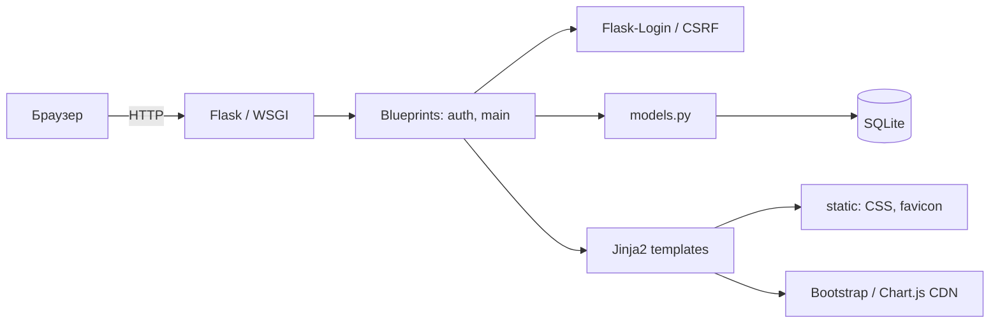
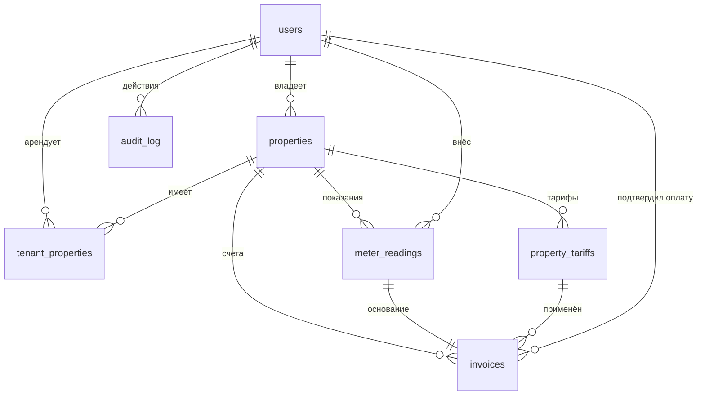

# Архитектура

## Назначение

«ЖКУ-Учёт» — монолитное веб-приложение на Flask для учёта показаний
приборов учёта и расчёта коммунальных платежей. Приложение не использует
ORM и внешние сервисы: данные хранятся в SQLite, интерфейс формируется на
сервере шаблонами Jinja2.

## Компоненты



| Модуль | Ответственность |
|---|---|
| `app.py` | фабрика `create_app`, логирование, обработчики 403/404/500, запуск сервера |
| `config.py` | `SECRET_KEY`, путь к БД, host/port, лимиты, cookie, логирование |
| `extensions.py` | `LoginManager`, `CSRFProtect`, соединение SQLite на запрос |
| `models.py` | пользователи, пароли, тарифы, объекты, доступ, показания, расчёт, счета, статистика, аудит |
| `utils.py` | декоратор `role_required`, проверка безопасного редиректа |
| `auth.py` | регистрация, вход/выход, профиль, смена пароля |
| `routes.py` | дашборд, объекты, тарифы, арендаторы, показания, история, оплата, CSV, статистика |
| `schema.sql` | DDL таблиц и индексов |
| `seed_demo.py` | сброс и наполнение демонстрационной БД |
| `templates/` | серверные шаблоны Bootstrap 5 |
| `tests/` | pytest-тесты с изолированной временной БД |

## Поток запроса

1. WSGI-сервер передаёт запрос Flask-приложению.
2. `create_app` уже загрузил конфигурацию и зарегистрировал blueprints:
   `auth` с префиксом `/auth` и `main` без префикса.
3. Для защищённых маршрутов Flask-Login проверяет сессию, затем
   `role_required` при необходимости проверяет роль.
4. Контроллер в `routes.py`/`auth.py` валидирует форму и вызывает функции
   `models.py`.
5. `models.py` выполняет параметризованные SQL-запросы через соединение из
   `extensions.get_db()`.
6. Контроллер делает `commit` или `rollback` и возвращает шаблон,
   редирект или CSV/JSON-ответ.
7. В конце запроса `close_db` закрывает соединение.

Соединение создаётся лениво и хранится в `flask.g` в пределах одного
запроса. Для каждого соединения включаются:

```sql
PRAGMA foreign_keys = ON;
PRAGMA journal_mode = WAL;
```

## Слои и правила

- **Представление**: Jinja2-шаблоны, Bootstrap 5, небольшие inline-скрипты
  для Chart.js и копирования кода приглашения.
- **Контроллеры**: разбор `request.form`, проверка прав, flash-сообщения,
  выбор шаблона и HTTP-кода.
- **Домен и данные**: `models.py` — единственное место, где выполняются
  SQL-запросы и расчёты.
- **Схема**: `schema.sql` применяется при старте через `init_db`; повторный
  запуск безопасен благодаря `CREATE TABLE IF NOT EXISTS`.

## Модель данных



Подробное описание полей и ограничений: [database.md](database.md).

## Расчёт

Расчёт сосредоточен в трёх функциях:

1. `save_reading` — проверяет дату и значения, создаёт/обновляет показание
   и запускает пересчёт.
2. `recalculate_property_invoices` — проходит все показания объекта по
   возрастанию даты, выбирает тариф на дату показания и создаёт/обновляет
   счёт.
3. `calculate_total` — вычисляет расход, слагаемые и итог, возвращает
   структуру для JSON-детализации.

Тариф выбирается запросом:

```sql
SELECT * FROM property_tariffs
WHERE property_id = ? AND effective_from <= ?
ORDER BY effective_from DESC, id DESC
LIMIT 1;
```

Если для даты показания тарифа нет, операция завершается ошибкой
`ValueError`, контроллер откатывает транзакцию и показывает сообщение.

Оплаченный счёт при пересчёте:

- если сумма не изменилась — остаётся оплаченным;
- если сумма изменилась — оплата снимается, в `audit_log` пишется
  `invoice.payment_revoked`.

## Безопасность

| Механизм | Реализация |
|---|---|
| Пароли | bcrypt, `bcrypt.gensalt()` |
| Сессия | Flask-Login, `HttpOnly`, `SameSite=Lax` |
| CSRF | Flask-WTF на всех POST-формах |
| SQL-инъекции | параметризованные запросы, без конкатенации пользовательских значений |
| XSS | автоэкранирование Jinja2 |
| Доступ | проверка роли и `user_can_access_property` |
| Open redirect | `is_safe_url` сверяет host и схему |
| Аудит | `audit_log` для входа, объектов, тарифов, показаний, счетов |

Ограничения учебной конфигурации:

- стандартный `SECRET_KEY` предназначен только для локального запуска;
- нет ограничения попыток входа и подтверждения email;
- встроенный сервер Flask не предназначен для production;
- SQLite рассчитан на один узел и умеренную нагрузку;
- резервное копирование не автоматизировано.

## Принятые решения

- **SQLite вместо ORM** — меньше зависимостей и наглядная схема для
  учебного проекта; все запросы явные и параметризованные.
- **Версии тарифов** — позволяют пересчитывать историю по правилам,
  действовавшим на дату показания.
- **JSON в `invoices.details`** — фиксирует расшифровку счёта на момент
  расчёта; при изменении тарифов старые данные не теряются.
- **Пересчёт всей истории объекта** — обеспечивает согласованность после
  изменения или удаления показания.
- **Аудит** — даёт проверяемый след значимых операций.

## Направления развития

- PostgreSQL и миграции (Alembic);
- WSGI-сервер Waitress/Gunicorn и reverse proxy;
- очередь уведомлений о новых счетах;
- экспорт счетов в PDF;
- резервное копирование по расписанию;
- ограничение попыток входа и двухфакторная аутентификация.
