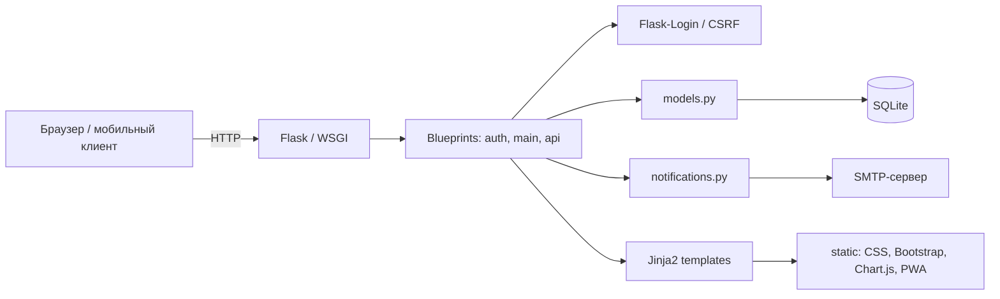
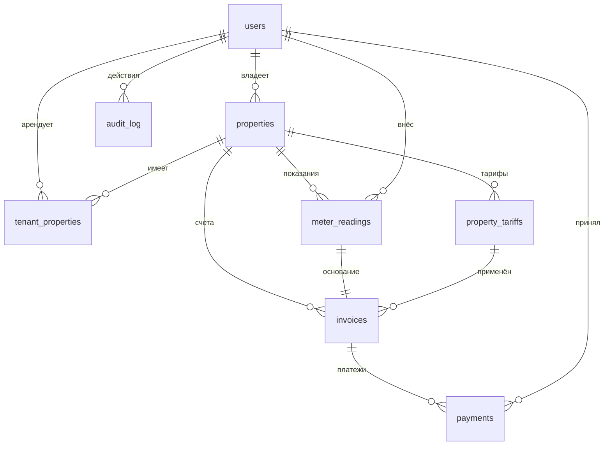

# Архитектура

## Назначение

«ЖКУ-Учёт» — монолитное веб-приложение на Flask для учёта показаний
приборов учёта и расчёта коммунальных платежей. Приложение не использует
ORM и внешние сервисы: данные хранятся в SQLite, интерфейс формируется на
сервере шаблонами Jinja2. Дополнительно доступен read-only REST API и
необязательная отправка email через SMTP.

## Компоненты



| Модуль | Ответственность |
|---|---|
| `app.py` | фабрика `create_app`, логирование, security-заголовки, обработчики 400/403/404/413/500 |
| `wsgi.py` | WSGI-точка входа для gunicorn |
| `config.py` | `SECRET_KEY`, путь к БД, host/port, cookie, лимиты входа, SMTP, логирование |
| `extensions.py` | `LoginManager`, `CSRFProtect`, соединение SQLite на запрос |
| `models.py` | пользователи, пароли, тарифы, объекты, архив, доли, показания, расчёт, счета, платежи, статистика, аудит, API-токены |
| `utils.py` | декоратор `role_required`, проверка безопасного редиректа |
| `auth.py` | регистрация, вход/выход, профиль, смена пароля, API-токены |
| `routes.py` | дашборд, объекты, тарифы, арендаторы, показания, история, платежи, печать, архив, аудит, CSV, статистика |
| `api.py` | read-only REST API `/api/v1` |
| `notifications.py` | отправка писем, счёта и напоминаний через `smtplib` |
| `migrations.py` | идемпотентные миграции существующей схемы |
| `schema.sql` | DDL актуальной схемы и индексов |
| `seed_demo.py` | сброс и наполнение демонстрационной БД |
| `scripts/backup_db.py` | согласованное резервное копирование SQLite |
| `scripts/send_reminders.py` | рассылка напоминаний о долге и показаниях |
| `templates/` | серверные шаблоны Bootstrap 5 |
| `tests/` | pytest-тесты с изолированной временной БД |

## Поток запроса

1. WSGI-сервер передаёт запрос Flask-приложению.
2. `create_app` загружает конфигурацию, применяет `schema.sql` и миграции,
   регистрирует blueprints: `auth` (`/auth`), `api` (`/api/v1`) и `main`.
3. Для защищённых маршрутов Flask-Login проверяет сессию, затем
   `role_required` при необходимости проверяет роль.
4. Контроллер в `routes.py`/`auth.py`/`api.py` валидирует входные данные и
   вызывает функции `models.py`.
5. `models.py` выполняет параметризованные SQL-запросы через соединение из
   `extensions.get_db()`.
6. Контроллер делает `commit` или `rollback` и возвращает шаблон,
   редирект, CSV или JSON-ответ.
7. В конце запроса `close_db` закрывает соединение.

Соединение создаётся лениво и хранится в `flask.g` в пределах одного
запроса. Для каждого соединения включаются:

```sql
PRAGMA foreign_keys = ON;
PRAGMA journal_mode = WAL;
PRAGMA synchronous = NORMAL;
```

## Слои и правила

- **Представление**: Jinja2-шаблоны, Bootstrap 5, локальные vendor-файлы,
  небольшие inline-скрипты для Chart.js и PWA.
- **Контроллеры**: разбор `request.form`/`request.args`, проверка прав,
  flash-сообщения, выбор шаблона и HTTP-кода.
- **Домен и данные**: `models.py` — единственное место, где выполняются
  SQL-запросы и расчёты.
- **Схема**: `schema.sql` создаёт актуальную схему для новой базы. Для
  существующих баз `init_db()` применяет миграции из `migrations.py` и
  фиксирует их версии в `schema_migrations`. Каждая миграция идемпотентна.
- **Транзакции**: функции изменения данных (кроме `recalculate_property_invoices`)
  не завершают транзакцию сами — `commit` делает вызывающий контроллер или
  скрипт. Это позволяет откатить всю операцию целиком при ошибке.

## Модель данных



Объекты не удаляются при архивировании: в `properties.archived_at`
записывается дата, а история и счета остаются в базе. Подробное описание
полей и ограничений: [database.md](database.md).

## Расчёт

Расчёт сосредоточен в функциях:

1. `save_reading` — проверяет дату и значения, создаёт/обновляет показание
   и запускает пересчёт.
2. `recalculate_property_invoices` — проходит все показания объекта по
   возрастанию даты, выбирает тариф на дату показания и создаёт/обновляет
   счёт. Фиксированная плата начисляется один раз в календарный месяц.
3. `calculate_total` — вычисляет расход, слагаемые и итог, возвращает
   структуру для JSON-детализации. Поддерживает зоны день/ночь.

Тариф выбирается запросом:

```sql
SELECT * FROM property_tariffs
WHERE property_id = ? AND effective_from <= ?
ORDER BY effective_from DESC, id DESC
LIMIT 1;
```

Если для даты показания тарифа нет, операция завершается ошибкой
`ValueError`, контроллер откатывает транзакцию и показывает сообщение.

Оплата счёта при пересчёте:

- если сумма не изменилась — счёт и все платежи остаются как есть;
- если сумма изменилась и по счёту были деньги — платежи удаляются,
  `paid` сбрасывается, в `audit_log` пишется `invoice.payment_revoked`;
- если счёт не был оплачен, достаточно обновить сумму и JSON-детализацию.

## Платежи и задолженность

- `invoices.paid` — признак полной оплаты;
- `payments` — отдельные платежи с суммой, датой, автором и комментарием;
- `paid_amount` вычисляется как `SUM(payments.amount)`;
- при достижении суммы счёта счёт закрывается автоматически;
- `mark_invoice_paid` добавляет недостающий остаток одним платежом;
- `mark_invoice_unpaid` удаляет все платежи и сбрасывает флаг оплаты;
- задолженность по объекту — сумма `total - paid_amount` по незакрытым
  счетам, но не меньше нуля.

## Доли арендаторов

`tenant_properties.share` задаёт вес арендатора. Если у объекта несколько
арендаторов, `get_invoice_split` нормализует доли так, чтобы сумма частей
равнялась сумме счёта; последняя часть получает остаток от округления.
Доли не обязаны в сумме давать 1 — это удобно при постепенном изменении
состава арендаторов.

## Безопасность

| Механизм | Реализация |
|---|---|
| Пароли | bcrypt, `bcrypt.gensalt()` |
| Сессия | Flask-Login, `HttpOnly`, `SameSite=Lax`, опционально `Secure` |
| CSRF | Flask-WTF на всех POST-формах |
| SQL-инъекции | параметризованные запросы, без конкатенации пользовательских значений |
| XSS | автоэкранирование Jinja2 |
| Доступ | проверка роли и `user_can_access_property` |
| Open redirect | `is_safe_url` сверяет host и схему |
| Перебор пароля | лимит попыток в памяти процесса (`MAX_LOGIN_ATTEMPTS`, `LOGIN_LOCKOUT_SECONDS`) |
| API | сессия или `Authorization: Bearer <api_token>`, токен можно отозвать |
| Заголовки | `X-Content-Type-Options`, `X-Frame-Options`, `Referrer-Policy`, `Permissions-Policy` |
| Аудит | `audit_log` для входа, объектов, тарифов, показаний, платежей, архива |

Ограничения учебной конфигурации:

- стандартный `SECRET_KEY` предназначен только для локального запуска;
- счётчик неудачных входов хранится в памяти процесса и сбрасывается при
  перезапуске; при нескольких процессах он не общий;
- SQLite рассчитан на один узел и умеренную нагрузку;
- резервное копирование не запускается автоматически — используйте
  `scripts/backup_db.py` или планировщик;
- SMTP-письма отправляются синхронно из запроса.

## PWA и офлайн-режим

`static/manifest.webmanifest` описывает установку приложения, а `/sw.js`
отдаёт service worker с областью действия `/`. Service worker кеширует
основные статические файлы и показывает `static/offline.html` при потере
сети. Динамические страницы всегда запрашиваются у сервера, поэтому данные
не кешируются и не устаревают.

## Принятые решения

- **SQLite вместо ORM** — меньше зависимостей и наглядная схема для
  учебного проекта; все запросы явные и параметризованные.
- **Версии тарифов** — позволяют пересчитывать историю по правилам,
  действовавшим на дату показания.
- **JSON в `invoices.details`** — фиксирует расшифровку счёта на момент
  расчёта; при изменении тарифов старые данные не теряются.
- **Пересчёт всей истории объекта** — обеспечивает согласованность после
  изменения или удаления показания.
- **Мягкий архив** — не удаляет финансовую историю и позволяет восстановить
  объект.
- **Отдельная таблица платежей** — даёт частичные оплаты и прозрачную
  историю поступлений, не усложняя таблицу счетов.
- **Read-only API** — мобильный клиент получает данные, но не может изменить
  финансовые записи.
- **Миграции в `schema_migrations`** — обновление существующей базы без
  потери данных и без ручных SQL-команд.

## Направления развития

- PostgreSQL и Alembic при росте нагрузки;
- асинхронная очередь писем;
- двухфакторная аутентификация;
- экспорт отчётов в Excel/PDF на сервере;
- автоматическое резервное копирование по расписанию;
- ограничение попыток входа на уровне reverse proxy для нескольких узлов.
