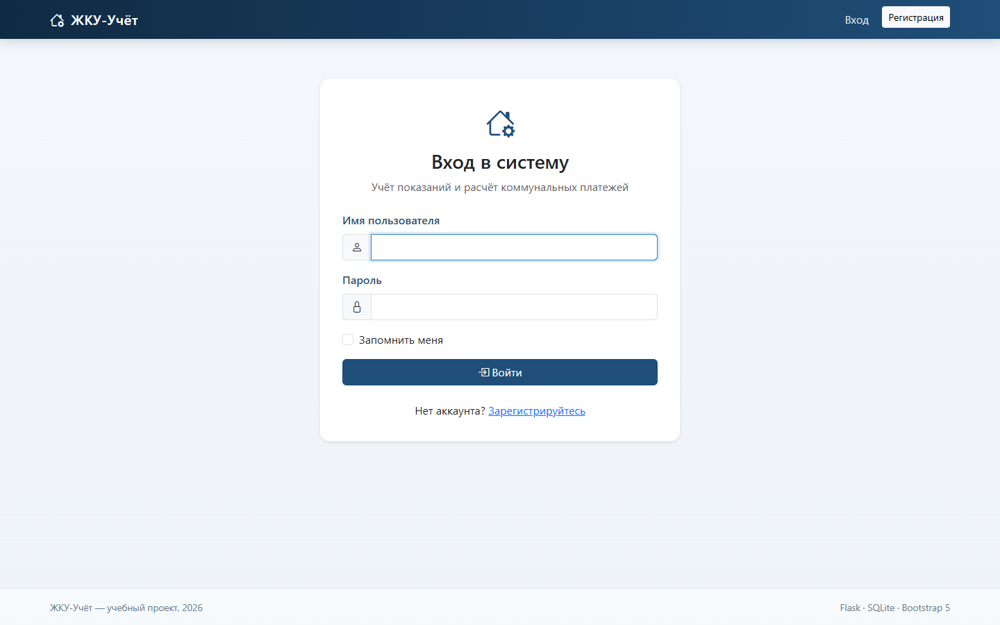
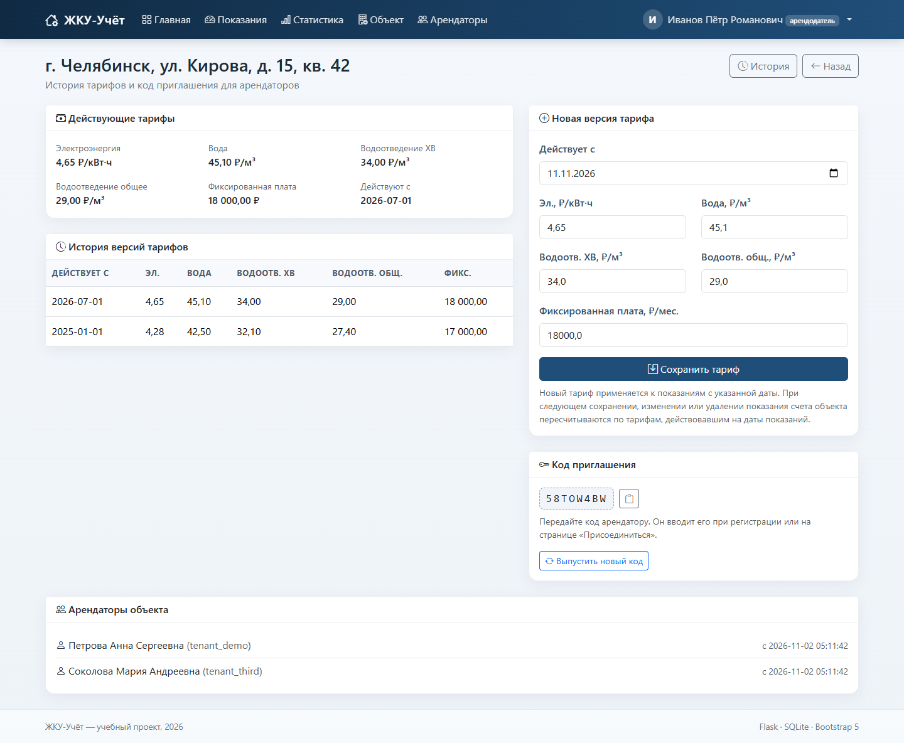
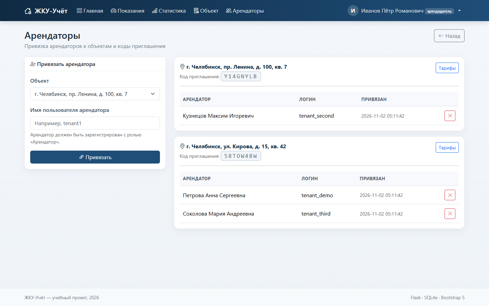
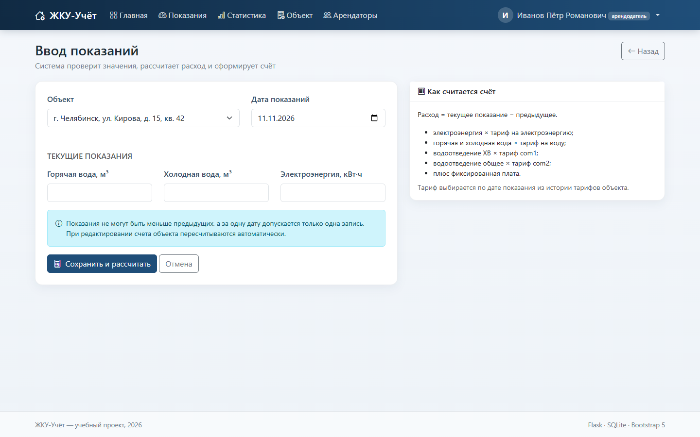
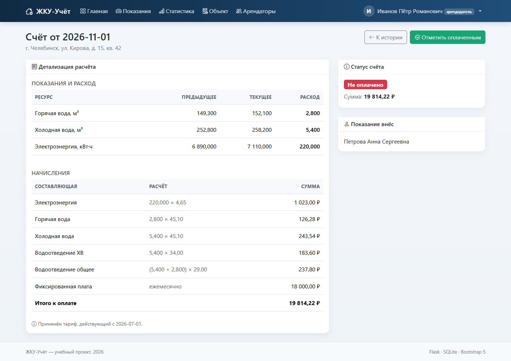
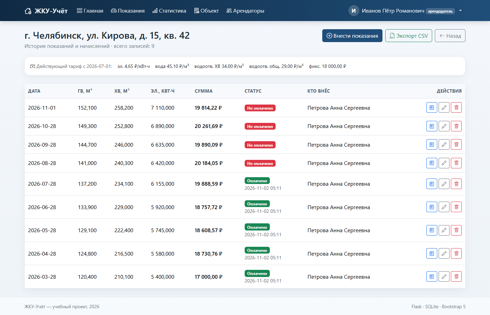
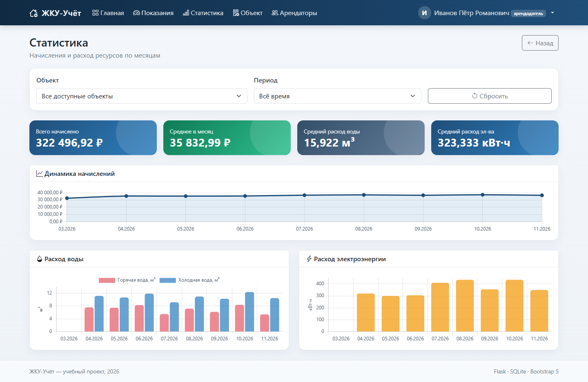
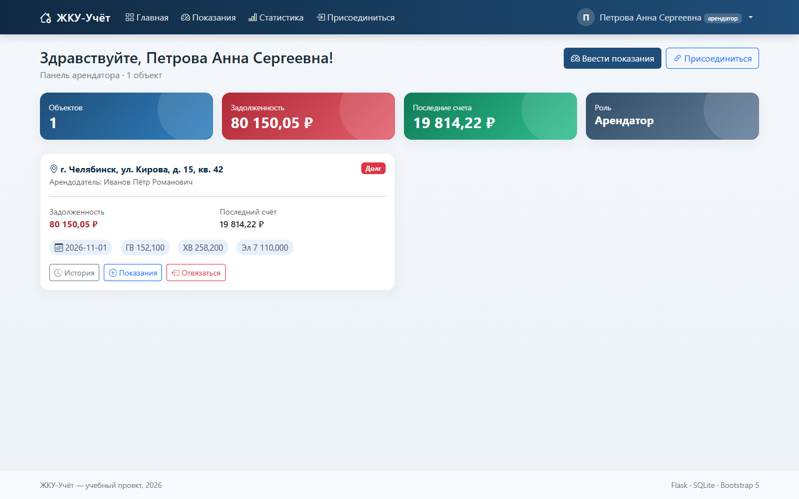
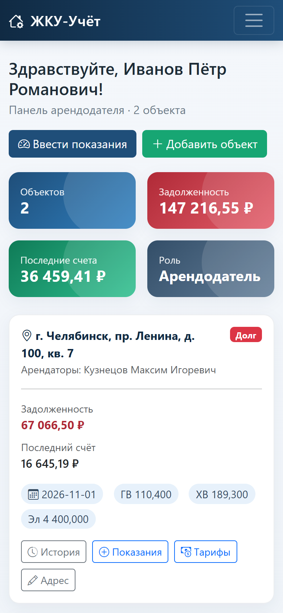

# Руководство пользователя

Система «ЖКУ-Учёт» помогает арендодателю вести объекты недвижимости,
тарифы и счета, а арендатору — передавать показания приборов учёта и
контролировать начисления.

## Роли

| Возможность | Арендодатель (`owner`) | Арендатор (`tenant`) |
|---|---|---|
| Создать объект и задать тарифы | да | нет |
| Изменять адрес и версии тарифов | да | нет |
| Выпускать код приглашения | да | нет |
| Привязывать и отвязывать арендаторов | да | нет |
| Вводить показания по своим объектам | да | да |
| Редактировать и удалять показания | да, по своим объектам | да, только свои |
| Смотреть историю и счета | да, по своим объектам | да, по доступным объектам |
| Подтверждать и отменять оплату | да | нет |
| Смотреть статистику и экспорт CSV | да | да |

Один арендодатель может вести несколько объектов. Один арендатор может
быть привязан к нескольким объектам, в том числе разных арендодателей.

## Регистрация и вход

1. Откройте страницу `Регистрация`.
2. Укажите имя пользователя (3–32 символа: латинские буквы, цифры, точка,
   дефис или подчёркивание), пароль не короче 8 символов и роль.
3. Арендатор может сразу ввести код приглашения — тогда после регистрации
   он будет привязан к объекту.
4. После регистрации войдите под своими учётными данными.

Если код приглашения не был указан при регистрации, арендатор может ввести
его позже на странице «Присоединиться».

## Сценарий арендодателя

### 1. Создание объекта

На панели нажмите «Добавить объект» и заполните:

- адрес объекта;
- дату, с которой действуют тарифы;
- тариф на электроэнергию, ₽/кВт·ч;
- тариф на воду, ₽/м³;
- водоотведение холодной воды, ₽/м³;
- общее водоотведение, ₽/м³;
- фиксированную плату, ₽/мес.

После сохранения система создаёт объект, первую версию тарифа и уникальный
код приглашения.

### 2. Тарифы и код приглашения

Страница «Тарифы» показывает действующие значения, историю версий, код
приглашения и привязанных арендаторов.

Новая версия тарифа вступает в силу с указанной даты. Для каждого показания
выбирается последний тариф, у которого `effective_from` не позже даты
показания. При следующем сохранении, изменении или удалении показания счета
объекта пересчитываются. Если сумма уже оплаченного счёта изменилась,
оплата снимается — арендодателю нужно подтвердить её заново.

Код приглашения можно передать арендатору или заменить кнопкой «Выпустить
новый код». Старый код после замены перестаёт действовать.

### 3. Привязка арендатора

Есть два способа:

- арендатор сам вводит код приглашения на странице «Присоединиться»;
- арендодатель открывает раздел «Арендаторы», выбирает объект, вводит логин
  зарегистрированного арендатора и нажимает «Привязать».

Отвязать арендатора можно кнопкой с крестиком. История показаний и счетов
объекта при этом сохраняется.

### 4. Ввод показаний

Нажмите «Ввести показания», выберите объект и дату, укажите текущие
значения горячей воды, холодной воды и электроэнергии.

Правила:

- за одну дату по объекту допускается только одна запись;
- показания не могут быть отрицательными;
- новые показания не могут быть меньше предыдущих;
- первое показание считается начальной точкой: расход по нему не
  начисляется, к оплате предъявляется только фиксированная плата.

После сохранения система создаёт счёт и показывает его детализацию.

### 5. Счёт и оплата

В счёте видны предыдущие и текущие показания, расход по каждому ресурсу,
ставки, слагаемые и итог. Например:

Арендодатель может нажать «Отметить оплаченным» или «Отменить оплату».
Арендатор видит статус счёта, но не может менять его.

### 6. История и экспорт

Страница «История» показывает все показания объекта, суммы, статусы оплаты
и автора записи. Кнопка «Экспорт CSV» выгружает таблицу с разделителем `;`
и BOM для корректного открытия в Excel.

### 7. Статистика

Раздел «Статистика» строит графики начислений, расхода воды и
электроэнергии. Можно выбрать один объект или все доступные, а также период:
6 месяцев, 12 месяцев или всё время.

### 8. Профиль

В меню пользователя доступны:

- «Профиль» — изменение полного имени и email;
- «Сменить пароль» — текущий пароль, новый пароль и подтверждение;
- «Выйти» — завершение сессии.

## Сценарий арендатора

1. Зарегистрируйтесь с ролью «Арендатор» или войдите в существующую учётную
   запись.
2. Присоединитесь к объекту по коду приглашения либо дождитесь, пока
   арендодатель привяжет вас по логину.
3. На панели видны доступные объекты, задолженность, последний счёт и
   последние показания.

4. Вводите показания через кнопку «Ввести показания». Арендатор может
   редактировать и удалять только те показания, которые внёс сам, и только
   по доступным ему объектам.
5. Смотрите историю, счета и статистику.
6. Кнопка «Отвязаться» удаляет привязку к объекту. История объекта остаётся
   у арендодателя.

## Мобильная версия

Интерфейс адаптирован для небольших экранов: меню сворачивается в кнопку,
карточки перестраиваются в одну колонку, таблицы получают горизонтальную
прокрутку.

  

## Типовые сообщения

| Сообщение | Причина | Что делать |
|---|---|---|
| «Показания за … уже введены» | на объект уже есть запись за эту дату | выберите другую дату или отредактируйте существующую |
| «Новые показания не могут быть меньше предыдущих» | значения меньше предыдущей записи | проверьте счётчики и дату |
| «Код приглашения не найден» | код введён с ошибкой или заменён | уточните актуальный код у арендодателя |
| «Недостаточно прав» | действие доступно другой роли | войдите под подходящей учётной записью |
| «Для даты … не задан тариф» | показание раньше первой версии тарифа | создайте тариф с более ранней датой |

## Демонстрационные данные

После `python seed_demo.py` доступны учётные записи с паролем `demo12345`:

| Логин | Роль |
|---|---|
| `owner_demo` | арендодатель |
| `owner_second` | арендодатель |
| `tenant_demo` | арендатор |
| `tenant_second` | арендатор |
| `tenant_third` | арендатор |

Демо-база содержит три объекта, историю показаний за несколько месяцев,
несколько версий тарифов и частично оплаченные счета.
